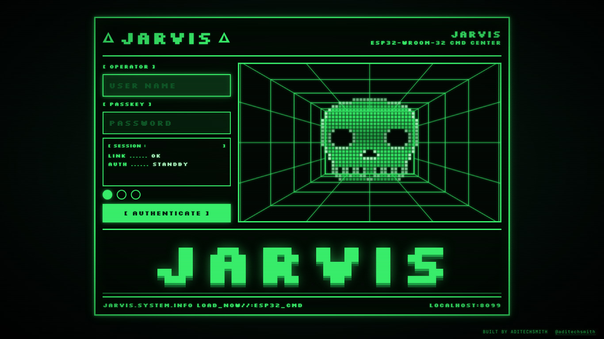
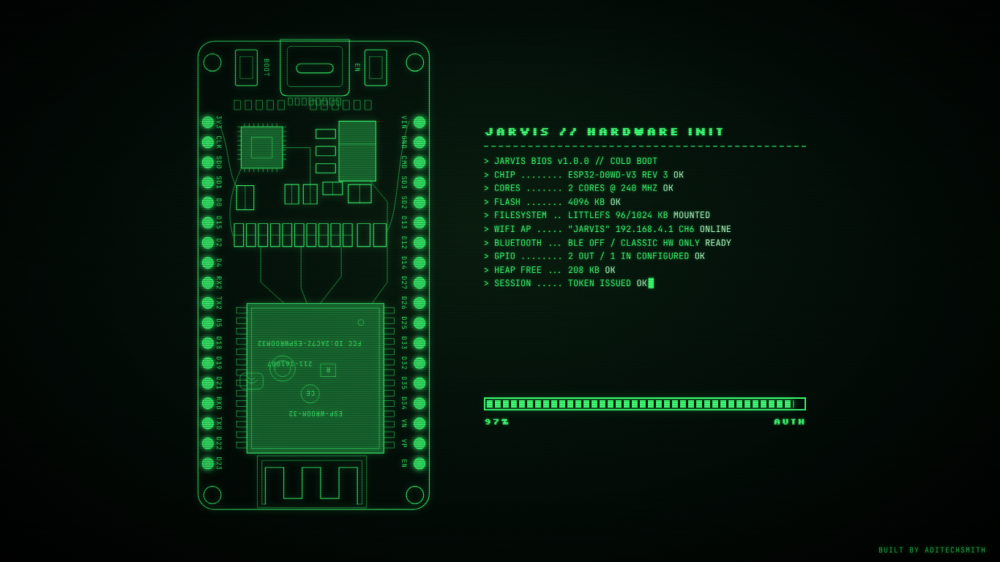
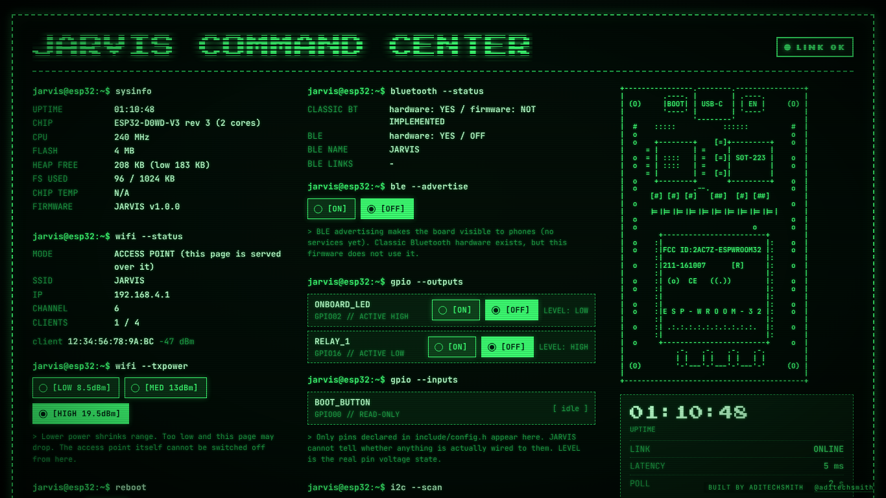

# VECTRON-32: Industrial Command Center & Instrumentation Console (v2.0)

[](https://github.com/debashis-sharingan-21/vectron-32/actions/workflows/build.yml)
[-red.svg?logo=espressif)](https://www.espressif.com/)
[](https://www.freertos.org/)
[](https://platformio.org/)
[](https://isocpp.org/)
[](https://github.com/ARMmbed/littlefs)
[](LICENSE)
[](https://github.com/debashis-sharingan-21)

**VECTRON-32** is a real-time SCADA instrumentation console, dual-core telemetry engine, and hardware security monitor engineered for the **ESP32-WROOM-32** microcontroller. Built with deterministic FreeRTOS symmetric multiprocessing (SMP), asynchronous WebSocket streaming at 10Hz, hardware-accelerated SHA-256 cryptographic provisioning, and an authentic retro-industrial cyber-matrix UI with 3D wireframe perspective rendering.

---

## Visual Tour & System Screenshots

| 01. Login: 3D Wireframe Tunnel & Pixel Skull | 02. CRT Access Granted Transition |
| :---: | :---: |
|  |  |
| **03. Vector ESP32 DevKit Boot Schematic Trace** | **04. SCADA Telemetry & Silicon Memory Map** |
|  |  |

---

## GitHub-Native Advisory Notices

> [!NOTE]
> **Default SoftAP Network & Terminal Parameters**:
> - **SSID**: `VECTRON-32`
> - **Default Gateway IP**: `http://192.168.4.1/`
> - **Captive Portal**: Automatic redirect on client association
> - **UART Baud Rate**: `115200 8-N-1`
> - **Default Access Key**: User `demo` / Pass `demo`

> [!TIP]
> **Zero-Hardware Local Simulation**:
> You can develop, test, and benchmark the complete web console locally without physical hardware using the built-in Node.js mock simulator:
> ```bash
> node tools/mock-server.js
> ```
> Open [http://localhost:8099/](http://localhost:8099/) in any browser (RFC 6455 WebSocket streaming included).

> [!IMPORTANT]
> **Flash Partition Layout Requirements**:
> VECTRON-32 requires the **Huge APP (3MB No OTA / 1MB SPIFFS)** partition scheme (`huge_app.csv`). You must flash both the LittleFS filesystem partition and the compiled firmware binary. For Arduino IDE users, follow the dedicated [Arduino IDE Setup Guide](docs/ARDUINO_IDE_SETUP.md).

> [!WARNING]
> **Hardware Pin Safety Policy**:
> Never connect output loads or external pull-ups to ESP32 strapping pins (**GPIO 0, 2, 12, 15**), internal SPI flash lines (**GPIO 6–11**), or UART0 programming pins (**GPIO 1, 3**). Doing so may prevent normal boot or corrupt onboard flash memory.

> [!CAUTION]
> **Industrial Wiring & Isolation Standards**:
> ESP32 GPIO logic thresholds operate strictly at **3.3V CMOS**. 5V inputs will damage the chip without level shifting. When switching inductive loads (relays, solenoids, DC motors), always employ optocoupler isolation and reverse flyback clamping diodes (e.g., 1N4007). See the [Hardware Guide](docs/HARDWARE_GUIDE.md).

---

## Quick-Access Directory Links

- 🛠️ **[PlatformIO Configuration](platformio.ini)** — Multi-environment production build settings.
- ⚡ **[Arduino IDE Standalone Sketch](arduino/vectron_32/vectron_32.ino)** — Turnkey sketch for Arduino IDE 2.x/1.8.x.
- 📖 **[Arduino IDE Complete Setup Guide](docs/ARDUINO_IDE_SETUP.md)** — Step-by-step flashing & board manager guide.
- 🔌 **[Hardware Wiring & Electrical Guide](docs/HARDWARE_GUIDE.md)** — Pin matrices, relay flyback schematics, and BOM.
- 🏗️ **[System Architecture Documentation](docs/ARCHITECTURE.md)** — FreeRTOS task schedules, state machines, and threat models.
- 💻 **[Local Mock Server Simulator](tools/mock-server.js)** — Zero-dependency Node.js simulation harness.

---

## System Architecture: Dual-Core FreeRTOS Division

VECTRON-32 strictly partitions workloads across the ESP32's dual Xtensa LX6 cores using FreeRTOS SMP task pinning. High-priority hardware telemetry execution on Core 1 is mathematically isolated from Core 0 network traffic:

```
┌────────────────────────────────────────────────────────────────────────┐
│                   ESP32-WROOM-32 (Dual-Core 240 MHz)                   │
├───────────────────────────────────┬────────────────────────────────────┤
│              CORE 0               │               CORE 1               │
│  [Network & Transport Engine]     │    [Instrumentation & HAL Engine]  │
│                                   │                                    │
│  ┌─────────────────────────────┐  │  ┌──────────────────────────────┐  │
│  │   vNetworkTask              │  │  │   vTelemetryTask (100ms)     │  │
│  │   - AsyncWebServer (:80)    │  │  │   - Hardware::service()      │  │
│  │   - AsyncWebSocket (/ws)    │◄─┼──│   - 10 Hz Telemetry Broadcast│  │
│  │   - Captive Portal DNS (:53)│  │  │   - I2C Auto-Discovery Engine│  │
│  │   - Session Cookie Auth     │  │  │   - LEDC PWM Engine & GPIO   │  │
│  │   - Static Asset Streaming  │  │  │   - RTC Lockout Diagnostics  │  │
│  └─────────────────────────────┘  │  └──────────────────────────────┘  │
│                 │                 │                 │                  │
│                 ▼                 │                 ▼                  │
│     AsyncTCP Non-Blocking Stack   │     Hardware Abstraction Layer     │
│     LittleFS Flash File Server    │     I2C Mutex (xSemaphoreMutex)    │
└───────────────────────────────────┴────────────────────────────────────┘
```

---

## Silicon Memory Map (520KB SRAM + 4MB SPI Flash)

```
==========================================================================
ESP32 INTERNAL MEMORY TOPOLOGY (520 KB SRAM)
==========================================================================
 0x3FFA_0000 ┌──────────────────────────────────────┐
             │ Internal ROM 1 (Data & System Calls) │ (128 KB)
 0x3FFB_0000 ├──────────────────────────────────────┤
             │ DRAM (Dynamic RAM / FreeRTOS Heap)   │ (176 KB Data / Dynamic)
             │   - FreeRTOS Task Stacks (8KB + 8KB) │
             │   - AsyncTCP Buffers & WS Frames     │
             │   - Dynamic Sensor Caches            │
 0x3FFE_0000 ├──────────────────────────────────────┤
             │ IRAM / DRAM Shared (D/I Cache Pool)  │ (128 KB Dual-Port)
 0x4000_0000 ├──────────────────────────────────────┤
             │ IRAM (Instruction RAM / Fast Code)   │ (128 KB Critical ISRs)
             └──────────────────────────────────────┘

==========================================================================
SPI FLASH PARTITION LAYOUT (4MB / huge_app.csv)
==========================================================================
 Offset      Size      Partition Name   Type   Subtype   Function
 ─────────────────────────────────────────────────────────────────────────
 0x00001000  0x007000  bootloader       app    boot      2nd Stage Bootloader
 0x00009000  0x005000  nvs              data   nvs       NVS Namespace ("vectron")
 0x0000E000  0x002000  otadata          data   ota       OTA Table Stub
 0x00010000  0x300000  app0 (huge_app)  app    ota_0     VECTRON Firmware (3.14 MB)
 0x00310000  0x0F0000  spiffs (LittleFS)data   spiffs    Web Assets Image (960 KB)
==========================================================================
```

---

## ESP32 DevKit V1 Hardware Pinout & Safety Matrix

The 38-pin DevKit board matrix strictly classifies every physical pad to safeguard against boot-mode locking, flash interface interference, and brownout triggers:

```
                      ┌───────────────────┐
                      │    [MICRO-USB]    │
               EN [01]│                   │[38] GND
     [ANALOG] VP  [02]│                   │[37] GPIO 23 [SAFE / MOSI]
     [ANALOG] VN  [03]│                   │[36] GPIO 22 [I2C SCL] ◄── BUS
     [ANALOG] G34 [04]│                   │[35] GPIO 01 [UART0 TX] ◄── LOCKED
     [ANALOG] G35 [05]│                   │[34] GPIO 03 [UART0 RX] ◄── LOCKED
     [ANALOG] G32 [06]│   ESP-WROOM-32    │[33] GPIO 21 [I2C SDA] ◄── BUS
     [ANALOG] G33 [07]│   WI-FI + BLE     │[32] GND
     [OUTPUT] G25 [08]│    DUAL-CORE      │[31] GPIO 19 [SAFE / MISO]
     [OUTPUT] G26 [09]│                   │[30] GPIO 18 [SAFE / SCK]
     [OUTPUT] G27 [10]│   ┌───────────┐   │[29] GPIO 05 [SAFE / RELAY 2]
     [OUTPUT] G14 [11]│   │    IC     │   │[28] GPIO 17 [SAFE / AUX]
  [STRAPPING] G12 [12]│   │  CP2102   │   │[27] GPIO 16 [SAFE / AUX]
              GND [13]│   └───────────┘   │[26] GPIO 04 [SAFE / RELAY 1]
  [STRAPPING] G13 [14]│                   │[25] GPIO 00 [BOOT BUTTON] ◄── STRAPPING
   [FLASH/SPI] D2 [15]│                   │[24] GPIO 02 [STATUS LED]  ◄── STRAPPING
   [FLASH/SPI] D3 [16]│                   │[23] GPIO 15 [STRAPPING]
  [FLASH/CMD] CMD [17]│  [EN]       [BOOT]│[22] D1      [FLASH/SPI]
  [FLASH/CLK] CLK [18]│  BTN         BTN  │[21] D0      [FLASH/SPI]
              5V  [19]│                   │[20] CLK     [FLASH/SPI]
                      └───────────────────┘
```

### Safety Classifications Legend
- **Green (Safe Outputs)**: GPIO 4, 5, 16, 17, 18, 19, 23, 25, 26, 27.
- **Cyan (Dedicated Inputs)**: GPIO 34, 35, 36, 39 (Analog/Sensors only; no internal pull-ups).
- **Blue (I2C Bus Engine)**: GPIO 21 (SDA), GPIO 22 (SCL) protected by FreeRTOS `xSemaphoreMutex`.
- **Red (System Blocked)**:
  - GPIO 6–11: Internal SPI flash memory bus (Connecting causes immediate CPU panic).
  - GPIO 1, 3: UART0 programming console interface.
  - GPIO 0, 2, 12, 15: Strapping pins determining boot voltage, flash voltage, and boot mode.

---

## 3-Tab Virtual Dashboard Architecture (SPA)

The web console operates as a client-side Single-Page Application (SPA) with three virtual views connected to a single persistent WebSocket stream:

1. **`[ TAB 1: SCADA CONSOLE ]`**:
   - **Reticle Oscilloscope (`<canvas id="telemetry-chart">`)**: 60-second rolling window graphing Free Heap, Core Temperature, and Connected Clients on an 8x10 green grid.
   - **Hardware Control Matrix**: Real-time latching toggle switches for relay outputs and pulse indicators for digital inputs.
   - **I2C Auto-Discovery Scanner**: Dynamic device map identifying OLEDs (0x3C), BME280s (0x76), and expanders (0x20).
   - **Diagnostics Console**: Monospace terminal log with severity filter tabs (`[INFO]`, `[WARN]`, `[ERROR]`, `[BUS]`).

2. **`[ TAB 2: SILICON MEMORY MAP ]`**:
   - **SRAM Allocator Gauges**: Live telemetry of Free Heap, Min Watermark, Heap Fragmentation %, and Max Free Block.
   - **Flash Partition Gauge**: Segmented visualization of bootloader, NVS namespace, application partition, and LittleFS.
   - **FreeRTOS Stack Watermarks**: Real-time stack headroom monitoring via `uxTaskGetStackHighWaterMark` for both cores.

3. **`[ TAB 3: BOARD & PINOUT INSPECTOR ]`**:
   - **Interactive DevKit SVG**: Full schematic board with interactive pin pads and traces.
   - **Status-Coded Lighting**: Active outputs glow neon green, inputs pulse cyan, bus pins illuminate blue, and restricted pins show crosshatched lockouts.
   - **Clickable Pin Matrix**: Clicking any physical pin on the SVG filters the hardware register table.

---

## Deployment & Getting Started

### Method A: PlatformIO (Recommended)

1. **Clone the repository**:
   ```bash
   git clone https://github.com/debashis-sharingan-21/vectron-32.git
   cd vectron-32
   ```
2. **Build and upload LittleFS filesystem assets**:
   ```bash
   pio run -e esp32dev --target uploadfs
   ```
3. **Compile and flash firmware binary**:
   ```bash
   pio run -e esp32dev --target upload
   ```
4. **Monitor serial console**:
   ```bash
   pio device monitor -b 115200
   ```

### Method B: Arduino IDE (Standalone)

1. Open `arduino/vectron_32/vectron_32.ino`.
2. Configure **Tools > Board** to `ESP32 Dev Module`.
3. Set **Tools > Partition Scheme** to `Huge APP (3MB No OTA/1MB SPIFFS)`.
4. Upload LittleFS assets using the **LittleFS Data Upload** plugin.
5. Click **Upload** (`➔`). Full instructions are documented in the [Arduino IDE Setup Guide](docs/ARDUINO_IDE_SETUP.md).

---

## REST & WebSocket Protocol Reference

### WebSocket Real-Time Telemetry Frame (`10 Hz`)
```json
{
  "t": "telem",
  "up": 1420,
  "heap": 184512,
  "heapMin": 164200,
  "heapFrag": 8.4,
  "temp": 41.2,
  "clients": 1,
  "gpio": {
    "out": [{"id": 0, "name": "ONBOARD_LED", "pin": 2, "on": true, "blocked": false}],
    "in": [{"id": 0, "name": "BOOT_BUTTON", "pin": 0, "active": false}]
  },
  "i2c": {
    "state": "done",
    "sda": 21,
    "scl": 22,
    "found": [{"addr": 60, "name": "SSD1306", "desc": "OLED Display 128x64"}]
  },
  "watermark": 4096
}
```

### WebSocket Hardware Command Frame
```json
{"cmd": "gpio", "id": 0, "state": 1}
{"cmd": "reboot"}
```

---

## License & Attribution

Distributed under the **MIT License**. Engineered and authored by **[debashis-sharingan-21](https://github.com/debashis-sharingan-21)**.
All brand names, trademarks, and registered hardware references belong to their respective holders.
